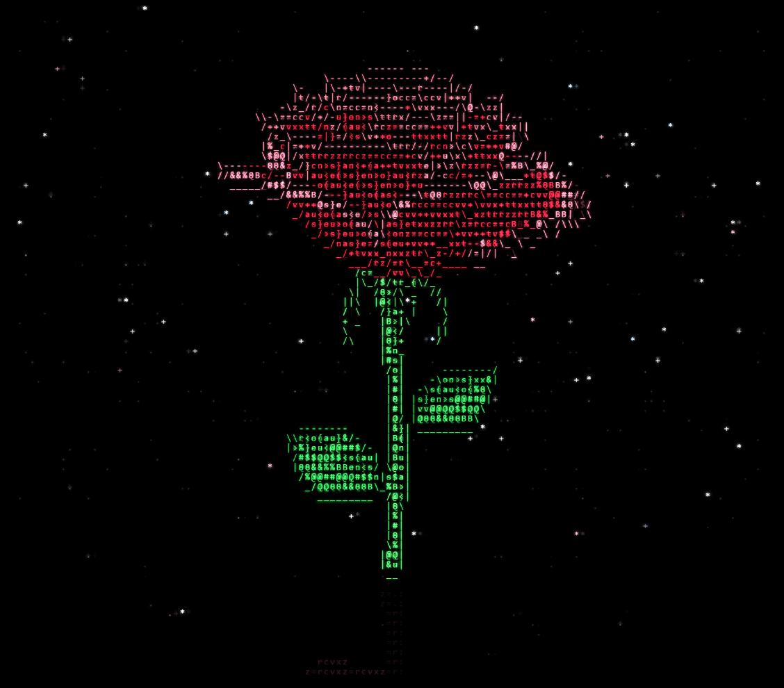
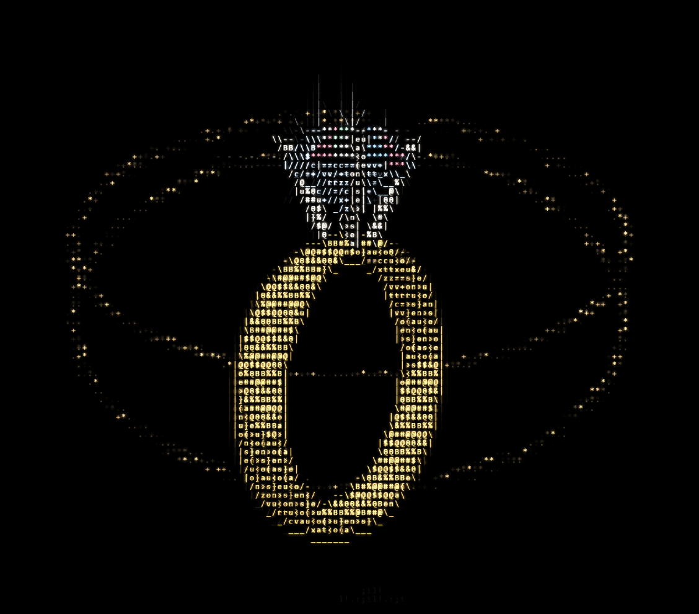

# ascii-3d-art

3D objects drawn only with characters. They're lit like a model, outlined with `| / \ - _`, and filled with letters that get denser where the light is brighter. A rose that grows and blooms, a diamond ring drawn in by a point of light, or anything you can describe as 3D surfaces.

It's three things: an engine, two finished scenes, and a Claude Code skill that teaches the method.

<p align="center">
  
  
</p>

## Why I made it

I wanted to make something cute for my girlfriend in this style, the character art JIN2 ([@jin_22ee](https://github.com/JIN2-ASCII)) makes. Claude couldn't do it, so I built the skill set: the method written down step by step, an engine that does it, and two finished scenes to learn from.

## What's in it

| Path | What it is |
| --- | --- |
| [`SKILL.md`](SKILL.md) | The skill: the method in eight steps, then tuning, traps, and advice for small pictures. With it installed, Claude Code uses it whenever someone asks for this kind of art. |
| [`scripts/ascii3d.js`](scripts/ascii3d.js) | The engine, a single ES module with no dependencies: surfaces with normals, lighting, projection, the character grid, outlines and fill, glints, particles, and a canvas renderer with trails and glow. |
| [`scripts/shapes.js`](scripts/shapes.js) | Two complete scenes. The rose grows, blooms and gathers dew. The diamond ring is drawn in by light, with a faceted stone that throws colour and two gold orbits. |
| [`scripts/demo.html`](scripts/demo.html) | Runs both scenes. |
| [`references/pipeline.md`](references/pipeline.md) | The formulas and the deeper tuning. |

## Run the demo

Browsers won't load module scripts from `file://`, so serve the folder:

```
cd scripts
python -m http.server 8000
```

Then open `http://localhost:8000/demo.html`. Add `?scene=ring` for the ring, or `?t=12` to hold the frame at 12 seconds.

## Use it as a Claude Code skill

Clone it into your skills folder:

```
git clone https://github.com/ChadisBrad/ascii-3d-art ~/.claude/skills/ascii-3d-art
```

On Windows, the folder is `%USERPROFILE%\.claude\skills\ascii-3d-art`. Then ask for something like "a rose made of characters that blooms" or "my logo as glowing 3D text art".

## Profile card

The same method, cut down for a GitHub profile. [ascii-profile-card](https://github.com/ChadisBrad/ascii-profile-card) draws a letter as slowly turning 3D ASCII art beside your name and a few facts. It's one static SVG that animates right in a README. It's a template, and it's the card on [my profile](https://github.com/ChadisBrad).

<p align="center">
  
</p>

## Credits

The method is after JIN2 ([@jin_22ee](https://github.com/JIN2-ASCII)), whose "IN BLOOM" rose and "WILL YOU" ring showed it. None of his code is here; this is an independent implementation written from the method. Please credit "after JIN2 (@jin_22ee)" wherever you show the result. His own code isn't licensed for commercial use without his permission.

## Licence

MIT. See [LICENSE](LICENSE).
